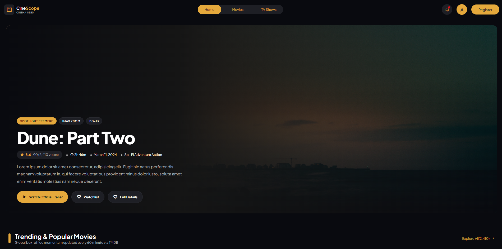
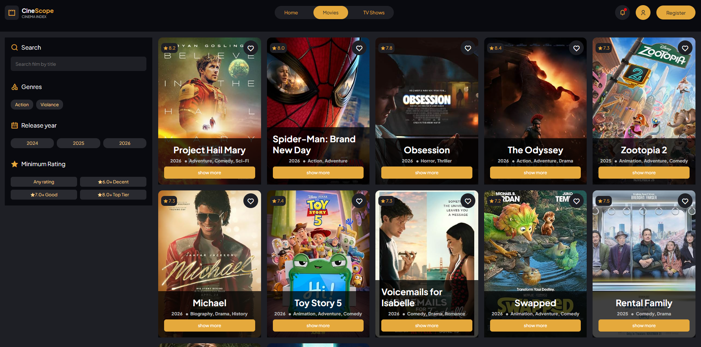
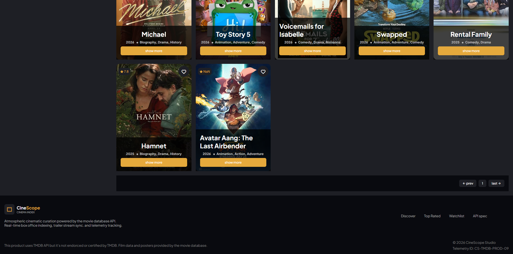
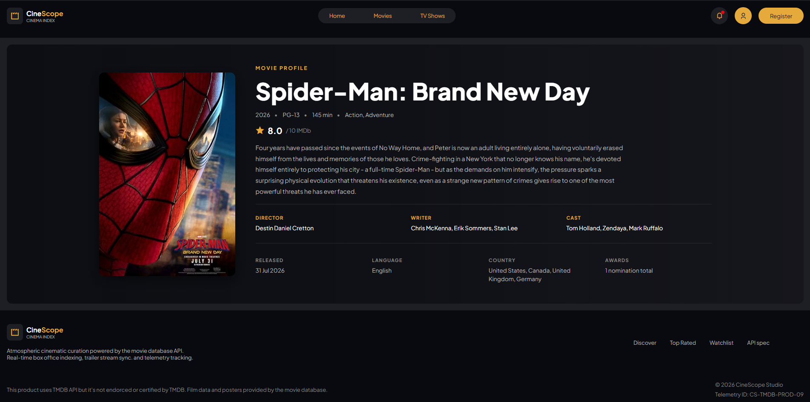

# Movie search application

This(SineScope) is a movie searching app where you can search and see your faviorate movies and find new movies.

This application uses two api trakat and omdb api beecause the avilability of different fildes.

## featuers

- Application consist of three pages home page, movies page and movies Detail page.
- This application uses trakt api(imdbID) and omdb api(single movie data).
- searching is done one current page data(12 objects)
- it is a responsive application

## how to run 

Open index.html file with live server.

## Preview

